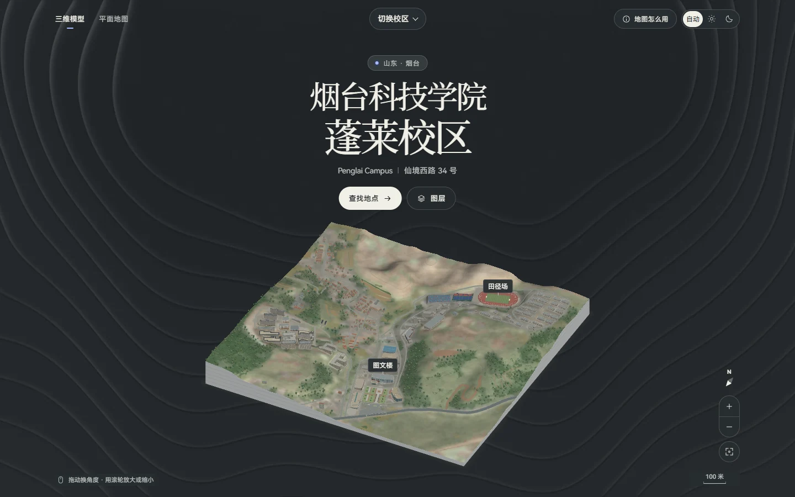

# 烟台科技学院校园图志

这是一个可以在浏览器里转动和放大的校园沙盘。你能在这里找教学楼、食堂、快递点，也能看看操场、道路和校园周边的山坡。

## 怎么打开

1. 点 GitHub 上的「Code → Download ZIP」，下载后解压。安装 [Python 3](https://www.python.org/downloads/)。
2. Windows 双击「打开校园.cmd」。macOS 或 Linux 在项目目录执行 `python3 serve.py`。
3. 浏览器会打开校园沙盘。如果没有自动打开，访问 [本地预览](http://127.0.0.1:8734/)。如果端口已被占用，使用终端显示的地址。

下载后，运行沙盘无需联网，也无需安装 Python 插件。

## 怎么看

- 用顶部的「切换校区」在**蓬莱校区**和**黄渤海校区**之间切换。蓬莱页面也包含东山片区。
- 用滚轮放大，拖动画面旋转。想从正上方认路时，点「平面地图」。
- 点一个地点查看名称和介绍。

## 代码在哪里

| 文件或目录 | 里面有什么 |
| --- | --- |
| `dist/` | 网页、3D 模型、地形、道路和地点数据 |
| `tools/` | 整理数据和生成模型的脚本 |
| `serve.py` | 启动本地网页的小程序 |
| [MODEL-NOTES.md](MODEL-NOTES.md) | 建模方法、数据来源和第三方资源说明 |

第三方地图、影像和字体的来源见 [建模依据与技术说明](MODEL-NOTES.md)。模型里的道路、建筑和地表依据地图、影像和现有资料校对。部分细节采用估算，现场通行和尺寸以实际情况为准。
